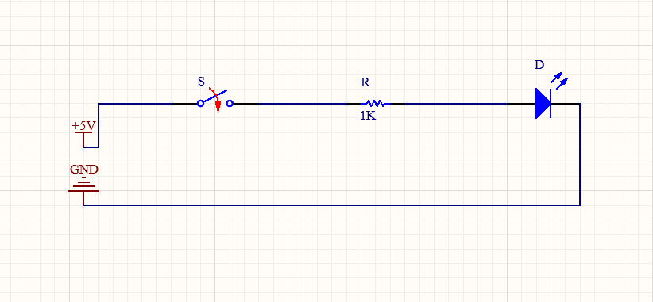

# Task01: Electrical Schematic

## Description
A simple electrical schematic of an LED indicator controlled by a switch.

## Components
- +5V power supply
- Switch (S1)
- Resistor (R1, 1 kOhm)
- LED (D1)
- Ground (GND)

## Schematic

## Software
Altium Designer

## Author
Shibiko Oleksandra
